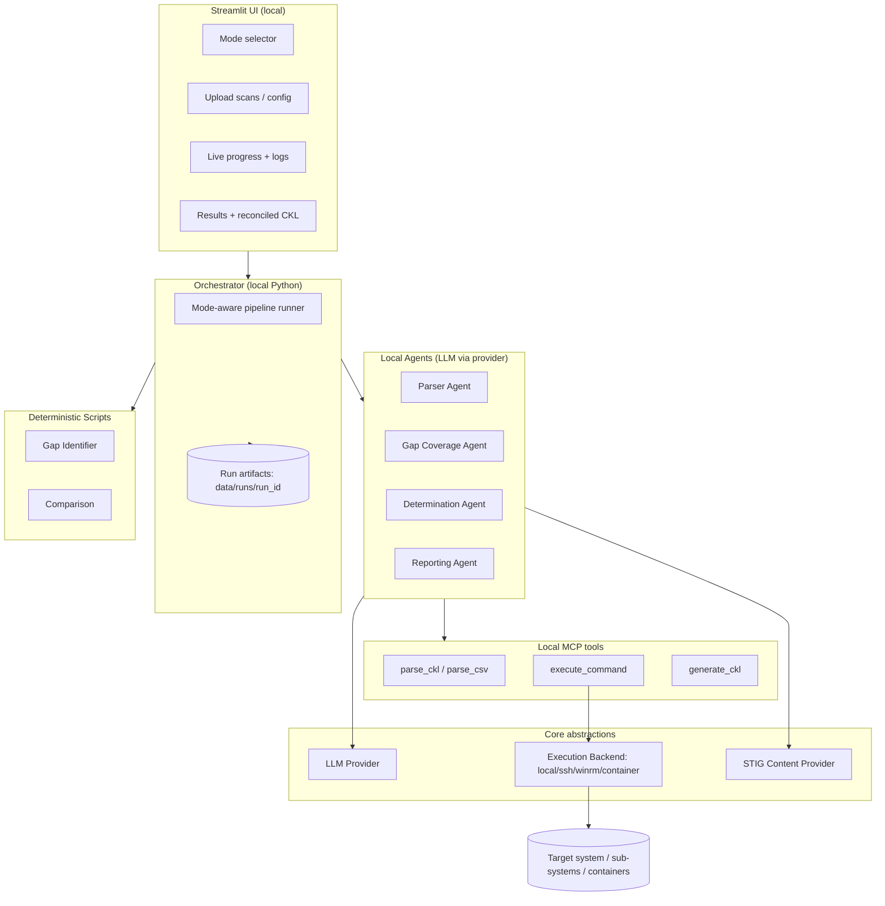

# ARES — Architecture & Data Flow

> **Status:** Living document. Target-state (local-first) architecture, the three core
> abstractions, and the exact per-step data flow. Update this whenever structure or schemas change.
> Last updated: 2026-08-16. See also: `MASTER_CONTEXT.md`, `.clinerules/01-architecture.md`.
> The pre-competition `docs/architecture.md` is archived at `docs/history/architecture_OLD.md`.

---

## 1. Design goals

- **Local-first:** everything runs locally and is packaged into a self-contained app. No Genesis-built
  agents, no OpenShift MCP, no Genesis RAG dependency.
- **Provider-agnostic LLM:** move dev (Genesis models) -> prod (classified lab GPU infra) by config only.
- **Transport-agnostic execution:** run Check Text commands locally on the target OR remotely (SSH/WinRM/
  container) behind one interface.
- **Content-agnostic STIG lookup:** fetch normalized rule content for any STIG/OS/software behind one interface.
- **One pipeline, three modes:** compare_scans, full_spot_check, version_delta share components.
- **Observable & reproducible:** every run and every LLM/command call is captured for review and testing.

---

## 2. High-level architecture



---

## 3. The three core abstractions

### 3.1 LLM Provider
- **Interface:** send a prompt (system + user + optional tool schema), get a completion (and any tool
  calls). Handles auth, base URL, model id, timeouts, retries, SSL, classification gating.
- **Configs:** `genesis` (dev), `lab` (prod GPU infra). Selected by config/env.
- **Multiple models / secondary validation:** the provider supports a **primary** and a distinct
  **secondary** model profile. Full Spot Check and Version Delta use the secondary model to independently
  re-validate Not_Reviewed / net-new / uncertain rules, so every rule gets multiple independent findings;
  LLM-vs-LLM disagreements are then resolved.
- **Rule:** agent logic NEVER references Genesis-specific endpoints/response shapes directly — only the
  provider interface.

### 3.2 Execution Backend
- **Interface:** `run(command, *, use_sudo, rule_id, timeout) -> {output, exit_code, error, duration_ms}`.
  All commands pass through the security validator + audit logger regardless of backend.
- **Backends (built 2026-11-14, `cli_executor/backends.py`):** `local`, `ssh` (any UNIX), `winrm`
  (Windows PowerShell), `config` (saved network-device configuration). OpenSCAP runs as a separate scan
  (`ares_api/scap.py`). `container` is still future. A run's saved target selects the backend and the
  platform's safety rules through `cli_executor/target_context.py`.
- **Rule:** agents/tools call the backend interface, never a transport library directly.

### 3.3 STIG Content Provider
- **Interface:** `get_rule(stig_id, rule_id) -> {check_text, discussion, severity, fix_text, cci, title, ...}`
  and `list_rules(stig_id)`.
- **Sources:** built-in RHEL 8 markdown (`data/input/RHEL_8_STIG_V2R7.md`, the fallback) and, since
  2026-11-14, the imported STIG library (`stig_library/`, `data/stig_library/`): any DISA XCCDF or SCAP
  benchmark, keyed by benchmark id + release. A run's choice is served through `get_stig_loader()`.

---

## 4. Pipeline & the three modes

The pipeline is a sequence of steps; each mode selects/parameterizes which steps run and how. Steps
are either **agents** (LLM) or **scripts** (deterministic). Every step reads the prior step's JSON
artifact and writes its own.

### 4.1 Compare Scans (`compare_scans`) — current mode
1. **Parser Agent** — parse scan A + scan B (CKL/CSV) -> normalized findings (via `parse_ckl`/`parse_csv`).
2. **Gap Identifier** (script) — find all Not_Reviewed (A-only, B-only, neither).
3. **Gap Coverage Agent** — validate Not_Reviewed via STIG content + `execute_command`.
4. **Comparison** (script) — categorize agreements vs disagreements across A, B, gap-coverage.
5. **Determination Agent** — resolve disagreements via STIG content + `execute_command`.
6. **Reporting Agent** — merge -> metrics, review queue, POA&M (SHOULD), reconciled CKL via `generate_ckl`.

### 4.2 Full Spot Check (`full_spot_check`) — new
1. **Parser Agent** — parse the one provided completed scan (baseline to compare against). A completed
   scan may still contain Not_Reviewed rules — ARES covers those.
2. **Independent Scan** — for EVERY rule in the STIG, ARES runs Check Text via `execute_command`
   (Gap Coverage Agent generalized to "all rules," not just Not_Reviewed). Includes sub-system discovery (future).
3. **Comparison** (script) — ARES findings vs the provided scan.
4. **Determination Agent** — resolve disagreements + cover anything Not_Reviewed.
5. **Secondary LLM validation** — any rule left Not_Reviewed or otherwise uncertain is re-validated with
   a **different LLM** (via the LLM Provider's secondary profile), so every rule gets multiple independent
   investigations; LLM-vs-LLM disagreements are then resolved.
6. **Reporting Agent** — reconciled CKL + metrics + POA&M.

### 4.3 Version Delta (`version_delta`) — new
1. **Parser Agent** — parse old scan + identify new STIG version rule set (via STIG Content Provider).
2. **Delta Script** (deterministic) — classify each rule: dropped / resolved / still-open / regressed /
   net-new / unchanged, by joining old findings to new rule set.
3. **Gap/Determination Agents** — resolve Not_Reviewed and ambiguous cases via CLI.
4. **Secondary LLM validation** — every **net-new** rule (present in the new STIG, absent in the old) and
   any Not_Reviewed/uncertain rule gets a **secondary validation with a different LLM**; disagreements resolved.
5. **Reporting Agent** — version-migration report + reconciled CKL for the new version.

> Implementation: shared building blocks (parse, content lookup, CLI validate, compare, resolve, report)
> with mode strategies — NOT three copies of the pipeline. Modes remain clearly separate and independently
> runnable, and may add their own custom steps (e.g. the secondary-LLM validation above).


---

## 5. Data flow (DATAFLOW)

All artifacts are JSON and written under `data/runs/<run_id>/steps/`. Canonical "latest" copies also go
to `data/output/`. The normalized finding shape is `mcp_server/schemas/finding_schema.py` (`Finding`).

### 5.1 Normalized Finding (common shape)
```json
{
  "group_id": "V-230221",
  "rule_id": "SV-230221r627750_rule",
  "stig_id": "RHEL-08-010000",
  "severity": "CAT I",
  "rule_title": "RHEL 8 must prevent direct root login",
  "discussion": "…",
  "check_text": "…",
  "fix_text": "…",
  "cci": "CCI-000366",
  "status": "Open | NotAFinding | Not_Applicable | Not_Reviewed",
  "finding_details": "…",
  "comments": null,
  "file_source": "rhel8-prestige-auto.ckl",
  "raw_data": {}
}
```

### 5.2 Per-step artifacts (Compare Scans)
- **parser** -> `{ "source_file", "parsed_at", "count", "findings": [Finding, …] }` per scan (A and B).
- **gap_identifier** -> `{ "gaps": [ {vuln_id, rule_id, reviewed_by: tool1_only|tool2_only|neither,
  requires_validation, reason} ], "statistics": {…} }`.
- **gap_coverage** -> `[ { vuln_id, rule_id, ares_verdict, confidence, requires_human_review,
  validation_source, finding_details, commands: [ {command, exit_code, output} ] } ]`.
- **comparison** -> `{ "agreements": [Finding-ish], "disagreements": [ {vuln_id, sources:{tool1,tool2,
  gap_coverage}, disagreement_type} ], "summary": {…} }`.
- **determination** -> `[ { vuln_id, rule_id, ares_verdict, confidence, requires_human_review,
  validation_source, commands: […] } ]`.
- **reporting** -> `{ "ckl_file", "metrics": {…}, "human_review_queue": [...], "poam_comments": {...},
  "recommendations": [...], "visualization_data": {...} }`.

> **KNOWN BUG:** comparison currently reports ~25 disagreements vs **41** hand-counted on the RHEL 8 test
> files. Likely ID matching / status normalization in `comparison_script.py`. Must be root-caused with a
> deterministic regression test against the golden dataset. Tracked in `ROADMAP.md`.

---

## 6. Observability (run artifacts)

Every run writes `data/runs/<run_id>/` (git-ignored):
- `inputs/` — input scans + resolved config.
- `steps/<NN>_<step>.json` — each step output (schemas above).
- `llm/<NN>_<agent>.json` — every prompt+response pair.
- `commands/<rule_id>.json` — every executed command (command, backend, exit code, stdout, stderr,
  duration, sudo).
- `run_summary.json` — mode, per-step timings, counts, errors, artifact paths.

This is what the project lead reviews instead of re-driving the UI, and the basis for regression fixtures.

---

## 7. Component locations (current -> target)

| Concern | Today | Target |
|---|---|---|
| Agents | mix of Genesis-built (parser) + local (`genesis_integration/`, `ui/orchestrator_runner.py`) | all local under a clear `agents/` package |
| Orchestration | `ui/orchestrator_runner.py` (1400+ lines) | slimmer mode-aware orchestrator, UI-agnostic core |
| MCP tools | `mcp_server/` (OpenShift-deployed) | local packaged MCP |
| CLI exec | `cli_executor/` (Fabric SSH) | Execution Backend abstraction (local/ssh/winrm/container) |
| STIG content | `genesis_integration/stig_loader.py` (RHEL 8 markdown) | STIG Content Provider (any STIG/OS) |
| LLM calls | `genesis_integration/agent_client.py`, `local_agent_executor.py` | LLM Provider abstraction |
| Schema | `mcp_server/schemas/finding_schema.py` | unchanged (extend deliberately) |
| UI | `ui/` (Streamlit single-page) | mode selector + shared components |

> The exact target package layout will be finalized in Phase 2 and documented here.

- **Rule:** agents get rule content ONLY through this provider (no Genesis RAG, no hardcoded paths).
