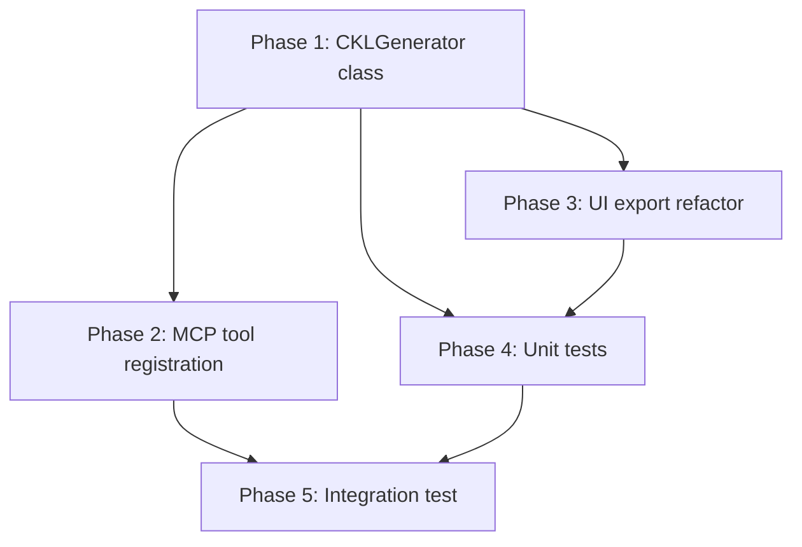

# CKL Generator Implementation Plan
## ARES - STIG Viewer-Compatible CKL Output Generation

**Priority**: 8B (Medium - part of Reporting Agent toolchain)  
**Status**: Planning  
**Created**: 2026-07-15  
**Author**: ARES team (AI-assisted)  
**Branch**: `feature/ckl-generator`  
**Estimated Time**: 3-5 hours  
**Blocks**: Reporting Agent full-functionality (MCP tool mode)  
**Depends On**: Parser Agent output schema (complete), Finding schema (complete)

---

## 1. Executive Summary

The CKL Generator produces STIG Viewer-compatible CKL XML files from ARES reconciled findings. This is the final output artifact of the pipeline — the file a cyber engineer opens in STIG Viewer to review reconciled results. A partial implementation exists in `ui/components/export.py` but it is minimal (3 STIG_DATA attributes per VULN, hardcoded asset info, string concatenation). The full implementation needs to:

1. Create a reusable `CKLGenerator` class at `mcp_server/generators/ckl_generator.py`
2. Register a `generate_ckl` MCP tool in `mcp_server/server.py` (per the spec)
3. Produce STIG Viewer-compatible XML with all required fields
4. Preserve original STIG metadata from parsed input files
5. Update `ui/components/export.py` to use the shared generator

**Risk**: Low. This is an additive feature with no impact on existing parsing or pipeline logic.

**Stakeholders**: Reporting Agent (new MCP tool dependency), Streamlit UI (refactored export code), end-user cyber engineers (receive CKL file in STIG Viewer).

---

## 2. Current State Analysis

### What Exists

| Component | File | Status | Notes |
|-----------|------|--------|-------|
| UI CKL export | `ui/components/export.py` | Minimal | 3 STIG_DATA attrs, hardcoded asset, string-building |
| MCP tool spec | `docs/mcp_tools_specification.md` | Documented | Full input/output schema defined |
| Reporting Agent prompt | `genesis_agents/reporting_agent_prompt.txt` | References `generate_ckl` | Expects MCP tool to exist |
| Finding schema | `mcp_server/schemas/finding_schema.py` | Complete | Has all STIG metadata fields |
| CKL parser (reference) | `mcp_server/parsers/ckl_parser.py` | Complete | Shows CKL XML structure |
| Real CKL samples | `test_data/tool1_prestige_scan.ckl` | Available | Reference for output format |

### What's Missing

| Component | Planned Location | Effort |
|-----------|-----------------|--------|
| `CKLGenerator` class | `mcp_server/generators/ckl_generator.py` | ~2 hours |
| `generate_ckl` MCP tool | `mcp_server/server.py` | ~30 min |
| Unit tests | `tests/test_ckl_generator.py` | ~1 hour |
| UI export refactor | `ui/components/export.py` | ~30 min |

### Gap Analysis: Current UI Export vs. STIG Viewer Requirements

The current `_generate_ckl()` in `export.py` produces XML that STIG Viewer may reject or display incorrectly because:

1. **ASSET section**: Missing `HOST_MAC`, `HOST_FQDN`, `TECH_AREA`, `TARGET_KEY`, `WEB_OR_DATABASE`, etc.
2. **STIG_INFO section**: Missing `stigid`, `classification`, `uuid`, `notice`, `source`, `filename`
3. **VULN elements**: Only includes `Vuln_Num`, `Rule_ID`, `Severity` — missing `Rule_Title`, `Rule_Ver`, `Group_Title`, `Check_Content`, `Fix_Text`, `Vuln_Discuss`, `CCI_REF`, `Weight`, `Class`, `STIGRef`, and 10+ other attributes
4. **FINDING_DETAILS**: Hardcoded to "ARES validated via CLI execution" instead of actual evidence
5. **No XML library**: Uses string concatenation (fragile, no encoding guarantees)

---

## 3. Requirements

### Functional Requirements

| ID | Requirement | Priority | Source |
|----|-------------|----------|--------|
| FR-1 | Generate valid CKL XML that opens in STIG Viewer 2.x without errors | Critical | Design Doc |
| FR-2 | Accept reconciled findings list with ARES verdict, confidence, source | Critical | MCP Spec |
| FR-3 | Accept metadata dict (hostname, STIG version, release info) | Critical | MCP Spec |
| FR-4 | Preserve original STIG metadata (Rule_Title, Check_Content, Fix_Text, etc.) when available | High | STIG Viewer compat |
| FR-5 | Include ARES evidence in FINDING_DETAILS and confidence in COMMENTS | High | Design Doc |
| FR-6 | Return `{success, ckl_content, filepath, finding_count}` response | Critical | MCP Spec |
| FR-7 | Write output file to `/data/output/` on MCP server (file-based architecture) | Medium | MCP Deployment |
| FR-8 | Expose as MCP tool callable by Reporting Agent via Genesis | Critical | Design Doc |
| FR-9 | Usable locally from Streamlit UI export (shared code) | Medium | UI Plan |
| FR-10 | Handle human review overrides (approved/overridden findings) | Medium | UI Spec |

### Non-Functional Requirements

| ID | Requirement | Target | Priority |
|----|-------------|--------|----------|
| NFR-1 | Generate 366-finding CKL in < 2 seconds | <2s | Medium |
| NFR-2 | Output XML is well-formed (parseable by any XML parser) | 100% | Critical |
| NFR-3 | Output CKL passes STIG Viewer import without warnings | 0 warnings | High |
| NFR-4 | Proper XML entity escaping for all user-provided text | No injection | Critical |
| NFR-5 | UTF-8 encoding throughout | UTF-8 | High |

### Technical Requirements

| ID | Requirement | Priority | Notes |
|----|-------------|----------|-------|
| TR-1 | Use `xml.etree.ElementTree` for XML generation (same lib as parser) | High | Consistency |
| TR-2 | Follow existing parser module pattern (`mcp_server/parsers/`) | High | Maintainability |
| TR-3 | Pydantic model for input validation | Medium | Match existing patterns |
| TR-4 | Compatible with MCP server file-based architecture (v1.3.0) | Critical | Server writes file, returns metadata |

---

## 4. Project Scope

### Assumptions
- STIG Viewer 2.x CKL format is the target (not STIG Viewer 3+ which uses CKLB/JSON)
- Input findings have already been reconciled (final_status determined)
- MCP server v1.3.0 file-based architecture pattern is followed (write file, return metadata path)
- **`raw_data` completeness varies by parser path**:
  - MCP server parser (v1.3.0, deployed): Extracts all VULN_ATTRIBUTE fields into `raw_data` — full CKL output
  - Local parser (`orchestrator_runner.py`): Only populates `raw_data` with `original_severity` and `original_status` — minimal CKL output (empty strings for missing STIG_DATA attributes)
  - Generator must handle both gracefully; output quality scales with input completeness

### Constraints
- Must work within the existing MCP server deployment on OpenShift
- Cannot add heavy dependencies (no lxml — stick with stdlib `xml.etree.ElementTree`)
- Generator has no access to the original CKL file on disk (must work from finding data alone)
- Aggressive timeline requires phased delivery — Phase 1-2 are minimum viable

### Out of Scope
- CKLB (JSON) output format (future enhancement)
- XCCDF/ARF output format
- Generating CKL from scratch without any input findings (always needs data)
- Validating CKL against an XSD schema (DISA doesn't publish one)
- Multi-STIG support (single iSTIG per output file for MVP)

---

## 5. Solution Architecture

### Approach: Shared Generator Module + Dual Interface

```
┌─────────────────────────────────────────────────────────────┐
│                     Consumers                                │
├─────────────────────────┬───────────────────────────────────┤
│  MCP Tool (generate_ckl)│   Streamlit UI (export.py)        │
│  Called by Reporting     │   Download button for user        │
│  Agent via Genesis       │                                   │
└───────────┬─────────────┴──────────────┬────────────────────┘
            │                            │
            ▼                            ▼
┌─────────────────────────────────────────────────────────────┐
│           mcp_server/generators/ckl_generator.py            │
│                                                             │
│  class CKLGenerator:                                        │
│    def generate(findings, metadata, asset_info) -> str      │
│    def generate_to_file(findings, metadata, ...) -> Path    │
│                                                             │
│  Internals:                                                 │
│    _build_asset_element(asset_info) -> Element              │
│    _build_stig_info(metadata) -> Element                    │
│    _build_vuln_element(finding) -> Element                  │
│    _build_stig_data(attribute, value) -> Element            │
└─────────────────────────────────────────────────────────────┘
```

### Key Design Decisions

1. **Proper XML generation via ElementTree** — not string concatenation. Ensures well-formed XML, proper encoding, and entity escaping automatically. Use `ET.tostring(root, xml_declaration=True, encoding='unicode')` for the declaration, and `ET.indent(root)` (Python 3.9+) for pretty-printing.

2. **Graceful degradation for missing metadata** — If findings don't include `check_text`, `fix_text`, etc. (e.g., in mock mode), output empty elements rather than omitting them. STIG Viewer expects all VULN_ATTRIBUTE entries to exist.

3. **Two-tier input**: Minimal (just vuln_id, status, severity) works for basic output; full metadata (all Finding schema fields + raw_data) produces STIG Viewer-perfect output.

4. **Asset info parameterized** — No more hardcoded hostname/IP. Passed in via metadata dict.

### Data Flow

```
Reporting Agent
    │
    ├── findings: [{vuln_id, rule_id, severity, status, finding_details, 
    │               comments, ares_confidence, validation_source, raw_data...}]
    │
    ├── metadata: {stig_title, version, release, hostname, host_ip, 
    │              reconciliation_date, stigid}
    │
    ▼
generate_ckl MCP tool
    │
    ├── Validates input (Pydantic)
    ├── Calls CKLGenerator.generate_to_file(...)
    ├── Writes to /data/output/reconciled_{timestamp}.ckl
    │
    ▼
Returns: {success: true, filepath: "...", finding_count: 366, ckl_content: "..."}
```

---

## 6. Implementation Plan

### Phase Summary

| Phase | Title | Priority | Depends On | Effort |
|-------|-------|----------|------------|--------|
| 1 | Create CKLGenerator class | Critical | None | ~2 hr |
| 2 | Register MCP tool | Critical | Phase 1 | ~30 min |
| 3 | Refactor UI export | Medium | Phase 1 | ~30 min |
| 4 | Testing & validation | High | Phase 1-3 | ~1 hr |
| 5 | Integration testing | Medium | Phase 2 | ~30 min |

### Phase 1: Create CKLGenerator Class

> **Goal**: Reusable CKL XML generation from reconciled findings using proper XML library.

**Tasks**:
- [ ] Verify `raw_data` contents from both parser paths (MCP server vs local) to understand available metadata
- [ ] Create `mcp_server/generators/` package directory with `__init__.py`
- [ ] Create `mcp_server/generators/ckl_generator.py` with `CKLGenerator` class
- [ ] Implement `generate(findings, metadata, asset_info) -> str` (returns XML string)
- [ ] Implement `generate_to_file(findings, metadata, asset_info, output_dir) -> Path`
- [ ] Build complete ASSET element from `asset_info` dict (all 13 fields)
- [ ] Build complete STIG_INFO element from `metadata` dict (all 11 SI_DATA entries)
- [ ] Build VULN elements with all 26 STIG_DATA attributes (graceful defaults for missing)
- [ ] Map ARES confidence/source into COMMENTS field
- [ ] Map actual evidence into FINDING_DETAILS field
- [ ] Apply human review overrides to STATUS
- [ ] Proper XML declaration and encoding

**Files to create**:
- `mcp_server/generators/__init__.py`
- `mcp_server/generators/ckl_generator.py`

**Definition of Done**: `CKLGenerator().generate(sample_findings, sample_metadata, sample_asset)` produces valid CKL XML that matches the structure in `test_data/tool1_prestige_scan.ckl`.

---

### Phase 2: Register MCP Tool

> **Goal**: Expose `generate_ckl` as an MCP tool callable by the Reporting Agent.

**Tasks**:
- [ ] Add `generate_ckl` tool definition to `mcp_server/server.py` via `@app.call_tool()` handler
- [ ] Add tool schema to `@app.list_tools()` with `findings` (list) and `metadata` (dict) params
- [ ] Implement file-based output pattern: write CKL to `/data/output/`, return metadata
- [ ] Handle errors gracefully (return `{success: false, error: "..."}`)
- [ ] Optionally return `ckl_content` in response for small files (< 1MB)

**Files to modify**:
- `mcp_server/server.py` (add tool registration + handler)

**Input Schema** (per MCP spec):
```json
{
  "type": "object",
  "properties": {
    "findings": {
      "type": "array",
      "description": "List of reconciled findings with final status"
    },
    "metadata": {
      "type": "object",
      "description": "STIG metadata: stig_title, version, release, hostname, etc."
    }
  },
  "required": ["findings", "metadata"]
}
```

**Definition of Done**: `generate_ckl` appears in `ListToolsRequest` response. Calling it with valid findings produces a CKL file at the returned filepath.

---

### Phase 3: Refactor UI Export

> **Goal**: Replace the minimal string-building `_generate_ckl()` in `export.py` with the shared `CKLGenerator`.

**Tasks**:
- [ ] Import `CKLGenerator` in `ui/components/export.py`
- [ ] Replace `_generate_ckl()` body with call to `CKLGenerator().generate(...)`
- [ ] Map session state data to the generator's expected input format
- [ ] Preserve human override decision logic
- [ ] Remove now-unused helper functions (`_ckl_severity`, `_ckl_status` if fully replaced)

**Files to modify**:
- `ui/components/export.py`

**Definition of Done**: Streamlit "Download CKL" button produces the same quality output as the MCP tool (full STIG_DATA attributes, parameterized asset info).

---

### Phase 4: Testing & Validation

> **Goal**: Verify output is valid XML and compatible with STIG Viewer format.

**Tasks**:
- [ ] Create `tests/test_ckl_generator.py`
- [ ] Test: valid XML output (parseable by ElementTree)
- [ ] Test: all 26 VULN_ATTRIBUTE entries present per finding
- [ ] Test: ASSET section has all required fields
- [ ] Test: STIG_INFO has all SI_DATA entries
- [ ] Test: STATUS values are valid CKL statuses (`Open`, `NotAFinding`, `Not_Reviewed`, `Not_Applicable`)
- [ ] Test: XML entities properly escaped in finding_details/comments
- [ ] Test: 366-finding generation completes in < 2 seconds
- [ ] Test: graceful handling of minimal input (only vuln_id + status)
- [ ] Test: human override decisions applied correctly
- [ ] Roundtrip test: parse generated CKL with existing `CKLParser`, verify findings match
- [ ] Test: UI export refactor produces valid CKL via shared generator (Phase 3 validation)

**Files to create**:
- `tests/test_ckl_generator.py`

**Definition of Done**: All tests pass. Generated CKL roundtrips through `CKLParser` with matching vuln_ids and statuses.

---

### Phase 5: Integration Testing

> **Goal**: End-to-end validation that the MCP tool works in the pipeline context.

**Tasks**:
- [ ] Test MCP tool via local server (call `generate_ckl` with pipeline output data)
- [ ] Verify file written to expected output directory
- [ ] Verify response format matches spec (`success`, `filepath`, `finding_count`)
- [ ] Test with Streamlit full pipeline output (mock mode → export CKL → validate)
- [ ] If possible: open generated CKL in STIG Viewer to confirm compatibility

**Definition of Done**: Full pipeline in mock mode produces a downloadable CKL that parses correctly and contains all expected findings with ARES evidence.

---

## 7. Detailed Implementation: CKLGenerator Class

### Core API

```python
class CKLGenerator:
    """Generate STIG Viewer-compatible CKL XML from reconciled findings."""

    # Default asset info (overridable)
    DEFAULT_ASSET = {
        "role": "None",
        "asset_type": "Computing",
        "host_name": "",
        "host_ip": "",
        "host_mac": "",
        "host_fqdn": "",
        "tech_area": "",
        "target_key": "",
        "marking": "CUI",
        "web_or_database": "false",
        "web_db_site": "",
        "web_db_instance": "",
        "target_comment": "",
    }

    # Default STIG_INFO (overridable)
    DEFAULT_STIG_INFO = {
        "title": "Red Hat Enterprise Linux 8 Security Technical Implementation Guide",
        "version": "2",
        "release": "Release: 7",
        "stigid": "RHEL_8_STIG",
        "classification": "UNCLASSIFIED",
        "notice": "terms-of-use",
        "source": "STIG.DOD.MIL",
    }

    # All VULN_ATTRIBUTE keys in standard CKL order
    VULN_ATTRIBUTES = [
        "Vuln_Num", "Severity", "Group_Title", "Rule_ID", "Rule_Ver",
        "Rule_Title", "Vuln_Discuss", "IA_Controls", "Check_Content",
        "Fix_Text", "False_Positives", "False_Negatives", "Documentable",
        "Mitigations", "Potential_Impact", "Third_Party_Tools",
        "Mitigation_Control", "Responsibility", "Security_Override_Guidance",
        "Check_Content_Ref", "Weight", "Class", "STIGRef", "TargetKey",
        "STIG_UUID", "CCI_REF",
    ]

    def generate(self, findings: list, metadata: dict, asset_info: dict = None) -> str:
        """Generate CKL XML string from reconciled findings."""

    def generate_to_file(self, findings, metadata, asset_info=None, output_dir="/data/output") -> Path:
        """Generate CKL and write to file. Returns output path."""
```

### Finding-to-VULN Mapping

| VULN_ATTRIBUTE | Source in Finding Dict | Fallback |
|---------------|----------------------|----------|
| `Vuln_Num` | `finding["vuln_id"]` (pipeline alias) → fallback `finding["group_id"]` (schema canonical) | Required |
| `Severity` | `finding["severity"]` → map CAT I/II/III to high/medium/low | "medium" |
| `Group_Title` | `finding.get("raw_data", {}).get("group_title")` | "" |
| `Rule_ID` | `finding["rule_id"]` | "" |
| `Rule_Ver` | `finding.get("stig_id")` or `raw_data.get("rule_ver")` | "" |
| `Rule_Title` | `finding.get("rule_title")` or `finding.get("title")` | "" |
| `Vuln_Discuss` | `finding.get("discussion")` | "" |
| `IA_Controls` | `finding.get("raw_data", {}).get("ia_controls")` | "" |
| `Check_Content` | `finding.get("check_text")` | "" |
| `Fix_Text` | `finding.get("fix_text")` | "" |
| `CCI_REF` | `finding.get("cci")` | "" |
| `Weight` | `raw_data.get("weight")` | "10.0" |
| `Class` | `raw_data.get("class")` | "Unclass" |
| `STIGRef` | Constructed from metadata title + version + release | "" |
| `Documentable` | `raw_data.get("documentable")` | "false" |
| STATUS | `finding["final_status"]` or `finding["status"]` | "Not_Reviewed" |
| FINDING_DETAILS | `finding.get("finding_details")` | "" |
| COMMENTS | Built from `ares_confidence` + `validation_source` + `file_source` + original comments | "" |

**Key implementation note**: The Finding schema uses `group_id` as the canonical field name for the vulnerability ID (e.g., "V-230221"). However, the pipeline orchestrator adds a `vuln_id` alias for downstream compatibility. The generator must check `vuln_id` first (most common in reconciled output), then fall back to `group_id` (direct schema output). Both refer to the same value.

---

## 8. Testing Strategy

### Test Scenarios

| Scenario | Input | Expected |
|----------|-------|----------|
| Basic generation | 3 findings, minimal fields | Valid XML with 3 VULN elements |
| Full metadata | Finding with all schema fields populated | All 26 STIG_DATA attrs filled |
| Missing optional fields | Finding with only vuln_id + status | Empty strings for missing attrs, no crash |
| XML escaping | Finding with `<>&"'` in details | Properly escaped entities |
| Large file | 366 findings (full RHEL 8) | Completes in < 2s, valid XML |
| Human override | Finding with overridden status | STATUS reflects override |
| Roundtrip | Generate CKL → parse with CKLParser | vuln_ids and statuses match |
| Asset parameterization | Custom hostname/IP | ASSET section reflects inputs |
| Severity mapping | CAT I, CAT II, CAT III inputs | Maps to high, medium, low |
| Status mapping | All valid statuses | Correct CKL STATUS values |

### Test Commands

```bash
# Unit tests
pytest tests/test_ckl_generator.py -v

# Roundtrip validation
python -c "
from mcp_server.generators.ckl_generator import CKLGenerator
from mcp_server.parsers.ckl_parser import CKLParser
# Generate then re-parse
"

# XML validity check
python -c "
import xml.etree.ElementTree as ET
ET.fromstring(open('output.ckl').read())
print('Valid XML')
"
```

---

## 9. Risk Assessment

### Risk Summary

| # | Risk | Probability | Impact | Score | Mitigation |
|---|------|------------|--------|-------|------------|
| R1 | STIG Viewer rejects output due to missing/malformed fields | Medium | High | 6 | Use real CKL as reference template; roundtrip test |
| R2 | Missing STIG metadata in findings (mock mode has limited data) | High | Low | 3 | Graceful defaults for all optional fields |
| R3 | Aggressive timeline limits polish time | Medium | Medium | 4 | Focus on MCP tool + basic generation first (Phase 1-2 as minimum viable); polish later |
| R4 | Large CKL generation slow in deployed container | Low | Low | 1 | ElementTree is fast; 366 elements is trivial |

### R1 Detail: STIG Viewer Compatibility

**Why it exists**: STIG Viewer's import parser may have undocumented requirements (specific attribute ordering, mandatory fields).

**Mitigation**:
- Mirror the exact structure of `test_data/tool1_prestige_scan.ckl` (known-good file)
- Include ALL 26 VULN_ATTRIBUTEs even when empty (STIG Viewer may expect them)
- Use same element ordering as real CKL files
- If possible, validate by importing generated CKL into STIG Viewer before demo

**Contingency**: If STIG Viewer rejects the output, the CSV export remains fully functional for the demo. Mention CKL as "beta" in presentation.

---

## 10. Success Criteria

### Functional
- [ ] `CKLGenerator` produces well-formed XML for any valid findings input
- [ ] `generate_ckl` MCP tool is callable and returns correct response format
- [ ] Generated CKL opens in STIG Viewer without import errors
- [ ] Streamlit export uses shared generator (no code duplication)
- [ ] All ARES evidence (confidence, source, CLI output) preserved in CKL

### Technical
- [ ] No new dependencies added (stdlib `xml.etree.ElementTree` only)
- [ ] All tests pass (`pytest tests/test_ckl_generator.py`)
- [ ] Roundtrip test passes (generate → parse → compare)
- [ ] Output matches structure of reference CKL files

### Quality
- [ ] Code follows existing patterns (module structure, docstrings, type hints)
- [ ] MCP tool matches documented specification in `docs/mcp_tools_specification.md`

---

## 11. Implementation Sequence

**Recommended order** (critical path first):



**First task to implement**: `mcp_server/generators/ckl_generator.py` — the core class. Everything else depends on it.

---

## Appendix A: Reference CKL Structure (from test_data/tool1_prestige_scan.ckl)

```xml
<?xml version="1.0" encoding="UTF-8"?>
<CHECKLIST>
  <ASSET>
    <ROLE>None</ROLE>
    <ASSET_TYPE>Computing</ASSET_TYPE>
    <HOST_NAME>rhel8-stig-lab</HOST_NAME>
    <HOST_IP>10.0.2.15</HOST_IP>
    <HOST_MAC>00:1A:2B:3C:4D:5E</HOST_MAC>
    <HOST_FQDN>rhel8-stig-lab.example.mil</HOST_FQDN>
    <TECH_AREA>UNIX</TECH_AREA>
    <TARGET_KEY>3765</TARGET_KEY>
    <MARKING>CUI</MARKING>
  </ASSET>
  <STIGS>
    <iSTIG>
      <STIG_INFO>
        <SI_DATA><SID_NAME>title</SID_NAME><SID_DATA>Red Hat Enterprise Linux 8 Security Technical Implementation Guide</SID_DATA></SI_DATA>
        <SI_DATA><SID_NAME>version</SID_NAME><SID_DATA>2</SID_DATA></SI_DATA>
        <SI_DATA><SID_NAME>releaseinfo</SID_NAME><SID_DATA>Release: 7 Benchmark Date: 24 Jan 2025</SID_DATA></SI_DATA>
        <SI_DATA><SID_NAME>stigid</SID_NAME><SID_DATA>RHEL_8_STIG</SID_DATA></SI_DATA>
      </STIG_INFO>
      <VULN>
        <STIG_DATA><VULN_ATTRIBUTE>Vuln_Num</VULN_ATTRIBUTE><ATTRIBUTE_DATA>V-230221</ATTRIBUTE_DATA></STIG_DATA>
        <STIG_DATA><VULN_ATTRIBUTE>Rule_ID</VULN_ATTRIBUTE><ATTRIBUTE_DATA>SV-230221r627750_rule</ATTRIBUTE_DATA></STIG_DATA>
        <STIG_DATA><VULN_ATTRIBUTE>Severity</VULN_ATTRIBUTE><ATTRIBUTE_DATA>high</ATTRIBUTE_DATA></STIG_DATA>
        <STIG_DATA><VULN_ATTRIBUTE>Rule_Title</VULN_ATTRIBUTE><ATTRIBUTE_DATA>RHEL 8 must install security-relevant software updates...</ATTRIBUTE_DATA></STIG_DATA>
        <STATUS>Open</STATUS>
        <FINDING_DETAILS>RHEL 8 operating system security patches...</FINDING_DETAILS>
        <COMMENTS>yum check-update shows 3 pending security patches</COMMENTS>
      </VULN>
    </iSTIG>
  </STIGS>
</CHECKLIST>
```

---

## Appendix B: MCP Tool Specification (from docs/mcp_tools_specification.md)

**Tool name**: `generate_ckl`  
**Version**: Planned for v1.1.0 (now v2.0.0)  
**Used by**: Reporting Agent  

**Input**:
```json
{
  "findings": [
    {
      "vuln_id": "V-230221",
      "rule_id": "SV-230221r627750_rule",
      "severity": "CAT II",
      "status": "NotAFinding",
      "finding_details": "ARES CLI validation: PermitRootLogin no",
      "comments": "Reconciled via autonomous validation",
      "ares_confidence": 95,
      "validation_source": "determination_agent"
    }
  ],
  "metadata": {
    "stig_title": "RHEL 8 STIG",
    "version": "V2R7",
    "release": "Release 7",
    "hostname": "rhel8-stig-lab",
    "reconciliation_date": "2026-07-08"
  }
}
```

**Output**:
```json
{
  "success": true,
  "ckl_content": "<?xml version=\"1.0\" encoding=\"UTF-8\"?>\n<CHECKLIST>...",
  "filepath": "data/output/reconciled_20260708_143522.ckl",
  "finding_count": 366
}
```

---

## Appendix C: Finding Schema Fields Available

From `mcp_server/schemas/finding_schema.py` — fields the generator can read:

| Field | Type | Available in Reconciled Output? |
|-------|------|-------------------------------|
| `group_id` (vuln_id) | str | Yes |
| `rule_id` | Optional[str] | Yes |
| `stig_id` | Optional[str] | Yes |
| `severity` | "CAT I"/"CAT II"/"CAT III" | Yes |
| `rule_title` | str | Yes |
| `discussion` | Optional[str] | If parsed from full CKL |
| `check_text` | Optional[str] | If parsed from full CKL |
| `fix_text` | Optional[str] | If parsed from full CKL |
| `cci` | Optional[str] | If parsed from full CKL |
| `status` | "Open"/"NotAFinding"/... | Yes |
| `finding_details` | Optional[str] | Yes |
| `comments` | Optional[str] | Yes |
| `file_source` | str (required) | Yes — source filename (e.g., "rhel8-prestige-auto.ckl") |
| `raw_data` | Optional[dict] | Yes (contains original parsed data) |

**Additional reconciliation fields** (added by pipeline, not in Finding schema):
- `final_status` — ARES determination
- `ares_confidence` / `confidence_score` — 0-100
- `validation_source` — "determination_agent", "gap_coverage_agent", "both_tools_agree"
- `tool1_status`, `tool2_status` — original tool verdicts
- `human_override` — boolean

---

## Appendix D: Severity Mapping

| ARES Internal | CKL XML Value | Display |
|---------------|---------------|---------|
| CAT I | high | Critical |
| CAT II | medium | Medium |
| CAT III | low | Low |

---

## Revision History

| Version | Date | Author | Changes |
|---------|------|--------|---------|
| 1.0 | 2026-07-15 | ARES team | Initial plan creation |
| 1.1 | 2026-07-15 | ARES team | Review fixes: clarified group_id/vuln_id naming, added file_source field, documented raw_data completeness by parser path, fixed Phase 4 dependencies, added ElementTree API notes, removed deadline reference |
