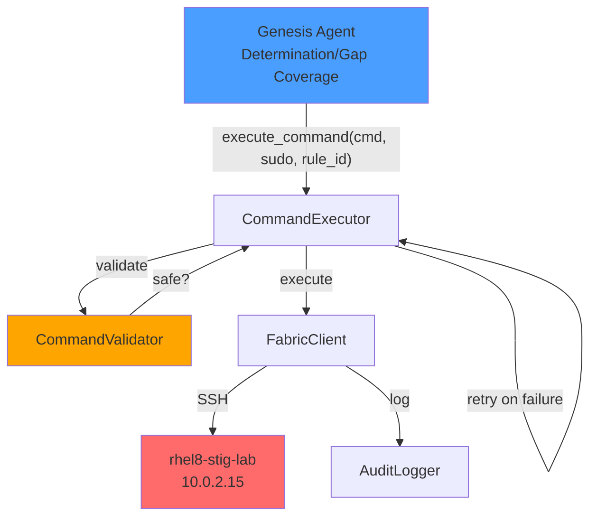
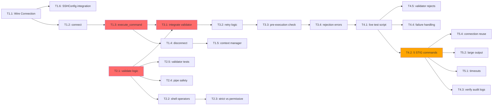

# CLI Executor Implementation Plan
## ARES - Fabric SSH Command Execution Module

**Priority**: 2A (Critical Path)  
**Status**: In Progress  
**Created**: 2026-07-06  
**Authors**: ARES team  
**Branch**: `cli-executor`  
**Estimated Time**: 4-6 hours remaining  
**Blocks**: Determination Agent (Priority 4), Gap Coverage Agent (Priority 6)

---

## 1. Executive Summary

The CLI Executor is the component that enables ARES to **autonomously validate STIG findings** by executing read-only commands on target systems via SSH. Without it, the Determination Agent and Gap Coverage Agent cannot resolve disagreements or fill gaps — they'd have no way to check ground truth on the actual system.

The team has scaffolded the module structure and implemented config validation. The remaining work is to uncomment/implement the core execution logic, wire in command safety validation, and test against the real VM.

---

## 2. Current State Analysis

### What's Done (Earlier commit: `8da5146`)

| File | Status | Notes |
|------|--------|-------|
| `cli_executor/config.py` | **Complete** | SSHConfig dataclass, env var loading, validation |
| `cli_executor/audit_logger.py` | **Complete** | Append-only JSONL logging, timestamped files |
| `cli_executor/test.py` | **Partial** | Only tests config validation |
| `cli_executor/__init__.py` | **Complete** | Exports FabricClient, AuditLogger |

### What Needs Implementation

| File | Status | Effort |
|------|--------|--------|
| `cli_executor/fabric_client.py` | Scaffolded (all TODOs) | ~1.5 hours |
| `cli_executor/executor.py` | Scaffolded (all TODOs) | ~1 hour |
| `security/command_validator.py` | Scaffolded (all TODOs) | ~1 hour |
| Integration tests | Not started | ~1.5 hours |

---

## 3. Requirements

### Functional Requirements

| ID | Requirement | Priority | Source |
|----|-------------|----------|--------|
| FR-1 | SSH to rhel8-stig-lab (10.0.2.15) via Fabric | Critical | Design Doc |
| FR-2 | Execute read-only commands and return stdout/stderr/exit_code | Critical | Design Doc |
| FR-3 | Support sudo execution for STIG checks that require it | Critical | Design Doc |
| FR-4 | Log every command execution to append-only audit trail | Critical | Security Req |
| FR-5 | Validate commands against blacklist before execution | High | Security Req |
| FR-6 | Retry failed commands up to 3 times | Medium | Resilience |
| FR-7 | Return structured result: `{output, exit_code, error, duration_ms}` | Critical | Agent Interface |
| FR-8 | Handle connection failures gracefully with clear error messages | High | Reliability |

### Non-Functional Requirements

| ID | Requirement | Target |
|----|-------------|--------|
| NFR-1 | Command execution latency | < 5 seconds per command |
| NFR-2 | Connection timeout | 30 seconds (configurable) |
| NFR-3 | Audit log integrity | Append-only, never modify past entries |
| NFR-4 | No write operations on target | Enforced via OS perms + blacklist |

### Interface Contract (What Genesis Agents Expect)

The Determination Agent and Gap Coverage Agent will call a function with this signature:

```python
def execute_command(command: str, use_sudo: bool = False, rule_id: str = None) -> dict:
    """
    Returns:
        {
            "output": str,       # stdout from command
            "exit_code": int,    # 0 = success, non-zero = error
            "error": str | None, # stderr or exception message
            "duration_ms": float # execution time
        }
    """
```

---

## 4. Solution Architecture

### Component Diagram



### Data Flow

```
1. Agent calls execute_command("grep PermitRootLogin /etc/ssh/sshd_config", rule_id="V-230221")
2. CommandExecutor.validate_command_safe() → checks blacklist
3. If safe → FabricClient.execute_command() → SSH to VM → run command
4. AuditLogger.log_command() → writes to data/logs/audit_YYYYMMDD_HHMMSS.jsonl
5. Return {output: "PermitRootLogin yes\n", exit_code: 0, error: None, duration_ms: 45}
```

---

## 5. Implementation Plan

### Phase Summary

| Phase | Description | Priority | Depends On |
|-------|-------------|----------|------------|
| Phase 1 | Implement FabricClient core | Critical | Config (done) |
| Phase 2 | Implement CommandValidator | Critical | None |
| Phase 3 | Implement CommandExecutor (orchestration) | Critical | Phase 1 + 2 |
| Phase 4 | Integration testing with real VM | Critical | Phase 1-3 |
| Phase 5 | Edge cases and hardening | Medium | Phase 4 |

---

### Phase 1: Implement FabricClient (`fabric_client.py`)

**Goal**: Working SSH connection and command execution via Fabric.

**Tasks**:

- [ ] T1.1: Wire up `__init__` with actual Fabric `Connection` object
- [ ] T1.2: Implement `connect()` with error handling
- [ ] T1.3: Implement `execute_command()` — run/sudo, capture output, measure duration
- [ ] T1.4: Implement `disconnect()` cleanup
- [ ] T1.5: Add context manager support (`__enter__`/`__exit__`) for safe cleanup
- [ ] T1.6: Wire `SSHConfig` into FabricClient initialization

**Implementation Details for T1.3** (most critical):

```python
def execute_command(self, command: str, use_sudo: bool = False, rule_id: str = None) -> Dict:
    import time
    start_time = time.time()
    
    try:
        if use_sudo:
            result = self.connection.sudo(command, hide=True, warn=True)
        else:
            result = self.connection.run(command, hide=True, warn=True)
        
        duration_ms = (time.time() - start_time) * 1000
        
        self.audit_logger.log_command(
            target_system="rhel8-stig-lab",
            target_ip=self.host,
            rule_id=rule_id or "UNKNOWN",
            agent="CLI_Executor",
            command=command,
            output=result.stdout,
            exit_code=result.return_code,
            duration_ms=duration_ms,
            use_sudo=use_sudo,
            error=result.stderr if result.stderr else None
        )
        
        return {
            "output": result.stdout,
            "exit_code": result.return_code,
            "error": result.stderr if result.stderr else None,
            "duration_ms": duration_ms
        }
    except Exception as e:
        duration_ms = (time.time() - start_time) * 1000
        logger.error(f"Command execution failed: {e}")
        return {
            "output": "",
            "exit_code": -1,
            "error": str(e),
            "duration_ms": duration_ms
        }
```

**Key decisions**:
- Use `warn=True` on Fabric run/sudo so non-zero exit codes don't throw exceptions (many STIG checks use exit code to indicate findings)
- Use `hide=True` to prevent output from printing to console
- Always log to audit trail, even on failure

**Definition of Done**:
- Can create FabricClient with SSHConfig
- Can connect to rhel8-stig-lab
- Can run `echo hello` and get output back
- Can run `sudo systemctl status sshd` with sudo
- Audit log entry created for each command

---

### Phase 2: Implement CommandValidator (`security/command_validator.py`)

**Goal**: Prevent dangerous/write commands from executing.

**Tasks**:

- [ ] T2.1: Implement `validate_command()` with blacklist checking
- [ ] T2.2: Handle shell operators (>, >>, |) that could write files
- [ ] T2.3: Implement strict mode (whitelist-only) vs permissive mode (blacklist-only)
- [ ] T2.4: Add pipe safety — allow `|` for read-only pipes (e.g., `grep | awk`) but block write redirects
- [ ] T2.5: Unit tests for validator (test each blacklist pattern + edge cases)

**Implementation Details for T2.1**:

```python
def validate_command(self, command: str) -> bool:
    command_lower = command.lower().strip()
    
    # Check for output redirection (file writes)
    if '>' in command and '|' not in command.split('>')[0]:
        # Allow ">" only inside quoted strings, block actual redirects
        logger.error(f"Output redirection detected: {command}")
        return False
    
    # Check for dangerous commands
    for dangerous in self.DANGEROUS_COMMANDS:
        # Match as word boundary to avoid false positives
        # e.g., "grep permit" should NOT match "rm"
        if self._matches_command(command_lower, dangerous):
            logger.error(f"Dangerous command pattern detected: '{dangerous}' in: {command}")
            return False
    
    return True

def _matches_command(self, command: str, pattern: str) -> bool:
    """Check if pattern appears as a command (not substring of another word)."""
    import re
    # Match pattern at start of command or after pipe/semicolon
    return bool(re.search(rf'(^|[|;&]\s*){re.escape(pattern)}(\s|$)', command))
```

**Key decisions**:
- Use regex word boundaries to avoid false positives (e.g., `grep "remove"` shouldn't match `rm`)
- Default to **permissive mode** (blacklist only) since OS-level read-only permissions are the primary defense
- Allow pipes for read-only chaining (`grep X | wc -l` is safe)
- Block output redirects (`>`, `>>`) unconditionally

**Definition of Done**:
- Blocks all patterns in DANGEROUS_COMMANDS list
- Allows common STIG validation commands (grep, cat, systemctl status, etc.)
- No false positives on legitimate STIG check commands
- Tests cover each dangerous pattern

---

### Phase 3: Implement CommandExecutor (`executor.py`)

**Goal**: High-level orchestrator that validates, executes, and retries.

**Tasks**:

- [ ] T3.1: Import and integrate CommandValidator
- [ ] T3.2: Implement retry logic with backoff
- [ ] T3.3: Add pre-execution validation step
- [ ] T3.4: Return clear error when command is rejected by validator
- [ ] T3.5: Add method to check connection health

**Implementation Details**:

```python
from security.command_validator import CommandValidator

class CommandExecutor:
    def __init__(self, client: FabricClient, strict_mode: bool = False):
        self.client = client
        self.validator = CommandValidator(strict_mode=strict_mode)
    
    def execute_validation_command(self, command: str, rule_id: str, 
                                   use_sudo: bool = False, max_retries: int = 3) -> Dict:
        # Step 1: Validate command safety
        if not self.validator.validate_command(command):
            return {
                "output": "",
                "exit_code": -2,
                "error": f"Command rejected by safety validator: {command}",
                "duration_ms": 0
            }
        
        # Step 2: Execute with retry
        last_result = None
        for attempt in range(max_retries):
            result = self.client.execute_command(command, use_sudo=use_sudo, rule_id=rule_id)
            
            # Success or definitive failure (non-zero exit is OK for STIG checks)
            if result["exit_code"] != -1:  # -1 means connection/SSH error
                return result
            
            # Connection error — retry with backoff
            last_result = result
            if attempt < max_retries - 1:
                import time
                time.sleep(2 ** attempt)  # 1s, 2s, 4s backoff
                logger.warning(f"Retry {attempt + 1}/{max_retries} for: {command}")
        
        return last_result
```

**Key decisions**:
- Only retry on connection errors (exit_code -1), NOT on non-zero exit codes (which are valid STIG check results)
- Exit code `-2` = rejected by validator (distinct from SSH failure)
- Exponential backoff: 1s, 2s, 4s
- Default `strict_mode=False` (blacklist only, per design doc recommendation)

**Definition of Done**:
- Rejected commands return immediately with clear error
- Connection failures retry up to 3 times
- Non-zero exit codes pass through (not treated as errors)
- All paths log to audit trail

---

### Phase 4: Integration Testing

**Goal**: Verify end-to-end execution against real rhel8-stig-lab VM.

**Tasks**:

- [ ] T4.1: Create test script that connects to VM and runs basic commands
- [ ] T4.2: Test 5 known STIG validation commands:
  - `grep -i PermitRootLogin /etc/ssh/sshd_config`
  - `systemctl is-enabled auditd`
  - `grep ENCRYPT_METHOD /etc/login.defs`
  - `sudo auditctl -l` (requires sudo)
  - `cat /etc/pam.d/password-auth`
- [ ] T4.3: Verify audit log entries are correct
- [ ] T4.4: Test connection failure handling (wrong host/port)
- [ ] T4.5: Test command validator rejects dangerous commands
- [ ] T4.6: Test retry logic (simulate transient failure)

**Test File** (`tests/test_cli_executor.py`):

```python
import pytest
from cli_executor.config import SSHConfig
from cli_executor.fabric_client import FabricClient
from cli_executor.executor import CommandExecutor

class TestLiveExecution:
    """Integration tests requiring SSH access to rhel8-stig-lab."""
    
    @pytest.fixture
    def executor(self):
        config = SSHConfig.from_env()
        client = FabricClient(
            host=config.host,
            user=config.user,
            password=config.password,
            key_filename=config.key_path
        )
        client.connect()
        yield CommandExecutor(client)
        client.disconnect()
    
    def test_basic_command(self, executor):
        result = executor.execute_validation_command("echo hello", rule_id="TEST-001")
        assert result["exit_code"] == 0
        assert "hello" in result["output"]
    
    def test_stig_grep_command(self, executor):
        result = executor.execute_validation_command(
            "grep -i PermitRootLogin /etc/ssh/sshd_config",
            rule_id="V-230221"
        )
        assert result["exit_code"] == 0
        assert "PermitRootLogin" in result["output"]
    
    def test_dangerous_command_rejected(self, executor):
        result = executor.execute_validation_command("rm -rf /tmp/test", rule_id="TEST-BAD")
        assert result["exit_code"] == -2
        assert "rejected" in result["error"]

class TestCommandValidator:
    """Unit tests for command validation (no SSH needed)."""
    
    def test_allows_grep(self):
        from security.command_validator import CommandValidator
        v = CommandValidator(strict_mode=False)
        assert v.validate_command("grep PermitRootLogin /etc/ssh/sshd_config") == True
    
    def test_blocks_rm(self):
        from security.command_validator import CommandValidator
        v = CommandValidator(strict_mode=False)
        assert v.validate_command("rm -rf /etc") == False
    
    def test_blocks_redirect(self):
        from security.command_validator import CommandValidator
        v = CommandValidator(strict_mode=False)
        assert v.validate_command("echo bad > /etc/passwd") == False
    
    def test_allows_pipe(self):
        from security.command_validator import CommandValidator
        v = CommandValidator(strict_mode=False)
        assert v.validate_command("grep ssh /etc/services | wc -l") == True
```

**Definition of Done**:
- All 5 STIG commands execute successfully on real VM
- Audit log contains correct entries
- Dangerous commands are blocked
- Connection failures produce clean error messages

---

### Phase 5: Edge Cases and Hardening

**Goal**: Handle real-world edge cases that will arise during the demo.

**Tasks**:

- [ ] T5.1: Handle command timeout (commands that hang)
- [ ] T5.2: Handle large output (truncate if > 10KB to prevent memory issues)
- [ ] T5.3: Handle commands that require interactive input (detect and abort)
- [ ] T5.4: Add connection pooling / reuse (don't reconnect per command)
- [ ] T5.5: Sanitize output (strip ANSI codes, handle encoding)

**Implementation for T5.1** (timeout):

```python
# In FabricClient.execute_command():
if use_sudo:
    result = self.connection.sudo(command, hide=True, warn=True, timeout=30)
else:
    result = self.connection.run(command, hide=True, warn=True, timeout=30)
```

**Implementation for T5.2** (output truncation):

```python
MAX_OUTPUT_SIZE = 10240  # 10KB
output = result.stdout
if len(output) > MAX_OUTPUT_SIZE:
    output = output[:MAX_OUTPUT_SIZE] + "\n... [TRUNCATED - output exceeded 10KB]"
```

---

## 6. Task Dependency Graph



---

## 7. Risk Assessment

| Risk | Probability | Impact | Mitigation |
|------|-------------|--------|------------|
| VM not accessible from dev machine | Medium | High | Test SSH connectivity immediately (Phase 4, T4.1) before coding more |
| Fabric sudo prompts for password interactively | Medium | Medium | Pass `password` in `connect_kwargs` for sudo, or configure NOPASSWD in sudoers |
| STIG commands need elevated perms we don't have | Low | High | Use `stig-checker` user with targeted sudo rules |
| Command validator false positives block valid STIG checks | Medium | Medium | Start permissive (blacklist only), tighten later after testing |
| Large command outputs cause memory/performance issues | Low | Medium | Truncate output at 10KB |

---

## 8. Success Criteria

- [ ] `SSHConfig.from_env()` loads credentials from environment
- [ ] `FabricClient` connects to rhel8-stig-lab successfully
- [ ] 5 real STIG validation commands return correct output
- [ ] `CommandValidator` blocks all dangerous patterns with zero false positives on valid STIG commands
- [ ] Retry logic handles transient SSH failures
- [ ] Audit log captures every execution with correct fields
- [ ] End-to-end: `CommandExecutor.execute_validation_command()` works as single entry point for Genesis agents

---

## 9. First Task to Implement

**Start with Phase 1, Task T1.1-T1.3**: Implement FabricClient core.

The code is already written as comments in `fabric_client.py` — uncomment, clean up, wire to `SSHConfig`, and test. This unblocks everything else.

**Immediately after**: Run `T4.1` (test SSH connection to real VM) to validate connectivity. If the VM isn't reachable, you'll know immediately and can troubleshoot networking rather than wasting time on code.
