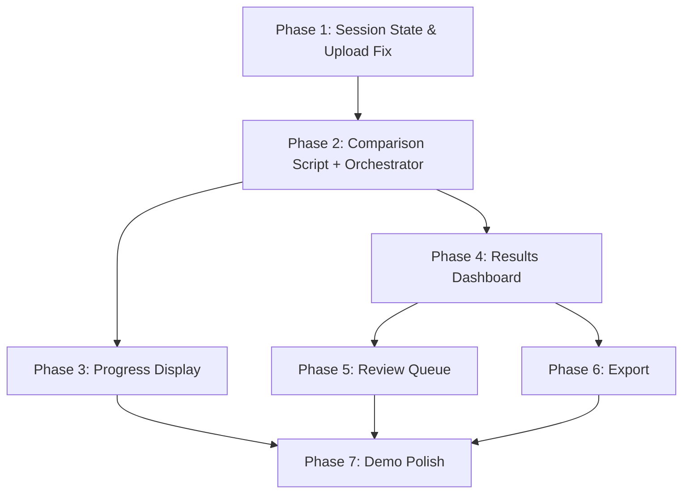

# Streamlit UI Implementation Plan

**Priority**: 9 (from team-design-doc)  
**Status**: In Progress  
**Created**: 2026-07-07  
**Last Updated**: 2026-07-09  
**Author**: ARES team  
**Branch**: `feature/streamlit-ui`

---

## Executive Summary

The Streamlit UI is the **orchestration layer and demo interface** for ARES. It replaces the single-agent chatbot interface with a full multi-agent workflow dashboard. It is responsible for:
1. Accepting scan file uploads (CKL/CSV only — NO CKLB in MVP)
2. Calling Genesis agents in sequence via the Python orchestrator
3. Running deterministic Python scripts (Gap Identifier, Comparison) locally
4. Displaying real-time progress (including live CLI execution)
5. Presenting results with human review capabilities
6. Exporting reconciled findings (CSV, CKL)

This is a **core feature** required for the competition demo — the "wow" moment is watching agents resolve disagreements via live SSH commands.

---

## Updated Pipeline (per the project lead's July 8 restructure)

**4 Genesis Agents + 2 Python Scripts:**

```
1. Upload         → Streamlit accepts CKL/CSV files (NO CKLB)
2. Parser Agent   → Genesis + MCP tools (parse_ckl, parse_csv) normalize findings
3. Gap Identifier → Python script (deterministic) — identifies ALL Not_Reviewed findings
4. Gap Coverage   → Genesis agent + RAG + CLI Executor validates gaps
5. Comparison     → Python script (deterministic) — categorizes agreements/disagreements
6. Determination  → Genesis agent + RAG + CLI Executor resolves ALL disagreements
7. Reporting      → Genesis agent generates reconciled CKL, metrics, POA&M, recommendations
8. Review Queue   → Streamlit displays low-confidence items (<80%) for human review
9. Export         → Download reconciled CKL/CSV
```

---

## Current State (as of July 9)

### File Structure

```
ui/
├── streamlit_app.py          — Main app (3 tabs: Upload, Progress, Results)
├── __init__.py
├── components/
│   ├── __init__.py
│   ├── upload.py             — File upload (basic — shows file details, no persistence)
│   ├── progress.py           — Fake simulation (timer-based, not wired to real agents)
│   ├── results.py            — Placeholder (st.info "under construction")
│   ├── metrics_dashboard.py  — Placeholder (all TODO comments)
│   └── review_queue.py       — Placeholder (all TODO comments)
└── pages/
    └── __init__.py
```

### What Works
- Tab navigation (Upload / Progress / Results)
- File upload accepts .ckl, .cklb, .csv and shows file metadata
- Progress page has a fake auto-run simulation with agent status badges

### What Doesn't Work
- Upload doesn't save files or persist to session state for downstream use
- Progress page is not connected to any real workflow — purely cosmetic
- Results page is empty
- No orchestration wiring (WorkflowOrchestrator and AgentClient are all `pass`/`{}`)
- No sample data flow (example_parser_output.json exists but is unused)
- Review queue is placeholder
- No export functionality

### Supporting Code Status

| Component | File | Status |
|:---|:---|:---|
| Gap Identifier | `genesis_integration/gap_identifier.py` | **DONE** — fully implemented, tested |
| Comparison Script | `genesis_integration/comparison_script.py` | **Skeleton** — all TODOs, no logic |
| Workflow Orchestrator | `genesis_integration/workflow_orchestrator.py` | **Skeleton** — all TODOs, returns `{}` |
| Agent Client | `genesis_integration/agent_client.py` | **Skeleton** — placeholder, no HTTP calls |
| Sample Parser Output | `mcp_server/example_parser_output.json` | **EXISTS** — 5 findings per tool, usable |

---

## Implementation Phases

### Phase 1: Session State Foundation & Upload Fix
> **Goal**: Establish the session state contract and make uploads actually persist data for downstream use.

**Tasks**:
- [ ] Define the complete `st.session_state` schema (all keys used across the pipeline)
- [ ] Fix upload component: save files to `data/input/` with session prefix OR keep in-memory bytes
- [ ] Store uploaded file references in `st.session_state.uploaded_files`
- [ ] Remove `.cklb` from accepted file types (not supported in MVP per architecture.md)
- [ ] Add "Use Sample Data" button that loads `mcp_server/example_parser_output.json` directly into `st.session_state.parser_output` (bypasses Parser Agent entirely for dev/demo)
- [ ] "Start Workflow" button sets `st.session_state.workflow_started = True` and switches to Progress tab
- [ ] Initialize all downstream session keys to `None` on workflow start

**Session State Schema**:
```python
st.session_state = {
    # Upload
    "uploaded_files": {"tool1_path": str, "tool2_path": str},
    "workflow_started": bool,
    "workflow_step": int,  # 0-7, current step index
    
    # Pipeline outputs (populated as each step completes)
    "parser_output": {"tool1_findings": [...], "tool2_findings": [...]},
    "identified_gaps": [...],
    "gap_coverage_results": [...],
    "comparison_output": {"agreements": [...], "disagreements": [...], "summary": {}},
    "determination_output": [...],
    "final_report": {...},
    
    # Human review
    "review_queue": [...],  # findings with confidence < 80%
    "review_decisions": {},  # {vuln_id: "approved" | "overridden:Open" | "overridden:NotAFinding"}
}
```

**Files to modify**:
- `ui/components/upload.py`
- `ui/streamlit_app.py`

**Definition of Done**: User uploads files (or clicks "Use Sample Data"), clicks "Start Workflow", and session state is properly initialized with data available for Phase 2.

---

### Phase 2: Implement Comparison Script + Orchestrator Runner
> **Goal**: Make the two Python scripts (Gap Identifier + Comparison) runnable from the UI, and build a mock-capable orchestrator runner.

**Tasks**:
- [ ] **Implement comparison_script.py** — fill in all TODOs:
  - `normalize_status()` — lowercase + strip separators → canonical values
  - `compare_findings()` — build maps, find common IDs, categorize agreements/disagreements
  - `merge_gap_coverage_findings()` — update tool findings with gap coverage validated statuses
  - `sort_by_severity()` — CAT I > CAT II > CAT III
  - `categorize_findings_by_severity()` — group by severity level
  - Handle all disagreement types: Tool1 vs Tool2, Tool1 vs Gap Coverage, Tool2 vs Gap Coverage, 3-way
- [ ] **Create `ui/orchestrator_runner.py`** — thin orchestration layer:
  - `run_pipeline(use_mock=True)` — runs all 7 steps in sequence
  - Each step updates `st.session_state.workflow_step` and writes output to session state
  - Mock mode: Parser returns sample JSON, Gap Coverage/Determination return pre-canned results
  - Real mode: calls GenesisAgentClient (for when API is available)
  - Gap Identifier + Comparison always run locally (Python, no mock needed)
- [ ] **Create mock agent responses** — `ui/mock_data.py`:
  - `MOCK_GAP_COVERAGE_OUTPUT` — realistic validated findings for the 5 sample rules
  - `MOCK_DETERMINATION_OUTPUT` — resolved disagreements with confidence scores + evidence
  - `MOCK_REPORTING_OUTPUT` — final report with metrics, recommendations

**Files to create/modify**:
- `genesis_integration/comparison_script.py` (implement)
- `ui/orchestrator_runner.py` (new)
- `ui/mock_data.py` (new)

**Definition of Done**: Running `orchestrator_runner.run_pipeline(use_mock=True)` populates all session state keys with realistic data from sample input → gap identifier → comparison → mock agents.

---

### Phase 3: Progress Display (Real Pipeline Execution)
> **Goal**: Replace the fake simulation with real step-by-step pipeline execution and show what's happening at each step.

**Tasks**:
- [ ] Rewrite `progress.py` to show actual pipeline steps (not the old agent list):
  1. Parser Agent (or "Using sample data" if mock)
  2. Gap Identifier (Python — instant)
  3. Gap Coverage Agent (shows CLI commands if available)
  4. Comparison Script (Python — instant)
  5. Determination Agent (shows CLI commands if available)
  6. Reporting Agent
- [ ] Each step shows: status badge (Pending/Running/Complete/Failed), duration, output summary
- [ ] For CLI-enabled agents (Gap Coverage, Determination), show:
  - Command executed in `st.code()` block
  - stdout output in terminal-style view
  - Exit code and duration
- [ ] Overall progress bar: "Step X of 6"
- [ ] "Run Workflow" button triggers `orchestrator_runner.run_pipeline()` and updates UI step by step
- [ ] Use `st.status()` containers for collapsible step details
- [ ] Show findings count at each step (e.g., "Gap Identifier: 2 gaps found")

**Files to modify**:
- `ui/components/progress.py` (rewrite)

**Definition of Done**: Clicking "Start Workflow" from upload tab runs the full pipeline (mock mode), progress page updates step by step showing each component's output, and ends with "Workflow Complete" state.

---

### Phase 4: Results Dashboard & Metrics
> **Goal**: Display final reconciled findings with summary metrics and charts.

**Tasks**:
- [ ] Implement `metrics_dashboard.py`:
  - 4 metric tiles: Total Rules, Agreements, Disagreements Resolved, Gaps Filled
  - Additional tile: "Requires Human Review" (count where confidence < 80%)
  - Pie chart (Plotly): status distribution (Open / NotAFinding / Not_Reviewed)
  - Bar chart (Plotly): severity breakdown (CAT I / II / III)
  - Tool accuracy comparison bar chart (if determination data available)
- [ ] Implement results table in `results.py`:
  - Columns: Vuln ID, Severity, ARES Verdict, Tool 1 Status, Tool 2 Status, Confidence, Source
  - Filters: severity dropdown, status dropdown, source dropdown (agreement/disagreement/gap)
  - Expandable rows showing evidence (commands executed, output)
  - Color-code by confidence (green ≥80%, yellow 60-79%, red <60%)
- [ ] "Time saved" metric: "Completed in X seconds (manual: 3-4 hours)"
- [ ] Wire results tab to show data from `st.session_state.final_report`

**Files to modify**:
- `ui/components/results.py` (rewrite)
- `ui/components/metrics_dashboard.py` (implement)

**Definition of Done**: After workflow completes, Results tab shows metric tiles, charts, and a filterable findings table populated from session state.

---

### Phase 5: Human Review Queue
> **Goal**: Allow reviewers to approve or override low-confidence findings.

**Tasks**:
- [ ] Implement `review_queue.py`:
  - Display findings where `confidence_score < 80`
  - For each flagged finding show:
    - Vuln ID, severity, rule title
    - ARES verdict + confidence score
    - Tool 1 vs Tool 2 statuses
    - Evidence: commands executed, stdout received
  - Action buttons per finding:
    - "Approve ARES Verdict" → stores approval in `st.session_state.review_decisions`
    - "Override → Open" / "Override → NotAFinding" → stores override
    - "Skip" → leaves in queue
  - Progress indicator: "3 of 4 reviewed"
- [ ] Integrate review queue into Results tab (below metrics, above export)
- [ ] Review decisions update `st.session_state.final_report` so export reflects human overrides

**Files to modify**:
- `ui/components/review_queue.py` (implement)
- `ui/components/results.py` (integrate)

**Definition of Done**: Low-confidence findings appear in a review queue. Human decisions are persisted and reflected in exports.

---

### Phase 6: Export
> **Goal**: Export final reconciled findings in downloadable formats.

**Tasks**:
- [ ] Create `ui/components/export.py`:
  - "Download Reconciled CSV" button — all findings with columns: vuln_id, severity, ares_verdict, tool1_status, tool2_status, confidence, source, evidence_summary, human_override
  - "Download Report JSON" button — full structured output including metadata, all pipeline step outputs
  - "Download Reconciled CKL" (stretch) — valid CKL XML for STIG Viewer (use generate_ckl logic or agent output)
- [ ] Include human review decisions in all exports
- [ ] Add export section to Results tab

**Files to create/modify**:
- `ui/components/export.py` (new)
- `ui/components/results.py` (add export section)

**Definition of Done**: User can download a CSV of reconciled findings that includes ARES verdicts, confidence scores, and human overrides.

---

### Phase 7: Demo Polish & Presentation Mode
> **Goal**: Make the UI polished for the pre-recorded competition demo video.

**Tasks**:
- [ ] Add ARES branding in sidebar or header
- [ ] Create `.streamlit/config.toml` with dark theme for video recording
- [ ] Add persistent sidebar:
  - Current workflow step
  - Time elapsed
  - Quick stats (findings processed, disagreements found)
- [ ] "Demo Mode" toggle — loads sample data, uses mock agents, runs end-to-end reliably
- [ ] Auto-advance tabs when workflow step completes (Upload → Progress → Results)
- [ ] Clean error states (no raw tracebacks — catch exceptions, show user-friendly messages)
- [ ] Responsive layout optimized for 1080p screen recording
- [ ] Fix any remaining CKLB references in UI text (should say CKL/CSV only)

**Files to modify**:
- `ui/streamlit_app.py` (sidebar, theme, auto-advance)
- `.streamlit/config.toml` (new — theme settings)
- All component files (polish pass)

**Definition of Done**: App looks professional in a 1080p screen recording. Demo mode runs full pipeline end-to-end without crashes or API dependencies.

---

## Dependency Graph



**Critical path**: Phase 1 → 2 → 3 + 4 (parallel) → 7

---

## Key Architecture Decisions

### Tab-Based Layout (not multi-page)

**Decision**: Use `st.tabs()` with shared session state in a single `streamlit_app.py`. Components are in `ui/components/`. This simplifies state management vs Streamlit's multi-page routing.

### Mock-First Development

**Decision**: Build with `use_mock=True` in the orchestrator runner. Real Genesis API calls swap in later when:
- Panel access is granted (MCP deployed)
- Genesis agents are created in the UI
- Agent Gateway API auth is configured

The mock layer produces the same data shapes as real agents would.

### Local Python Scripts Run Directly

**Decision**: Gap Identifier and Comparison Script are NOT agents — they run as direct Python function calls within the Streamlit process. No API roundtrip, instant results.

### Data Format Flow Through UI

```
Upload (.ckl/.csv files)
    ↓
st.session_state.uploaded_files = {tool1_path, tool2_path}
    ↓
Parser Agent → st.session_state.parser_output
    {"tool1_findings": [...], "tool2_findings": [...]}
    ↓
Gap Identifier (Python) → st.session_state.identified_gaps
    [{"vuln_id": ..., "reviewed_by": "tool1_only", ...}]
    ↓
Gap Coverage Agent → st.session_state.gap_coverage_results
    [{"vuln_id": ..., "status": "NotAFinding", "confidence_score": 95, ...}]
    ↓
Comparison Script (Python) → st.session_state.comparison_output
    {"agreements": [...], "disagreements": [...], "summary": {...}}
    ↓
Determination Agent → st.session_state.determination_output
    [{"vuln_id": ..., "ares_verdict": "Open", "confidence_score": 92, ...}]
    ↓
Reporting Agent → st.session_state.final_report
    {"reconciled_findings": [...], "metrics": {...}, "review_queue": [...]}
    ↓
Human Review → st.session_state.review_decisions
    {"V-230221": "approved", "V-230225": "overridden:Open"}
    ↓
Export (CSV / JSON / CKL)
```

---

## Testing Strategy

| Layer | How to Test |
|:---|:---|
| File upload | Manual — upload real scan files, verify session state populated |
| Gap Identifier | Unit test (already works) — verify with sample data |
| Comparison Script | Unit test — verify agreements/disagreements match expected |
| Orchestrator Runner | Unit test — mock mode produces expected session state |
| Progress display | Manual — verify UI updates step by step |
| Results/metrics | Manual — verify charts render with sample data |
| Review queue | Manual — approve/override and verify state changes |
| Export | Verify CSV matches expected schema, opens in Excel |
| End-to-end | Demo mode runs full pipeline without errors |

---

## Success Criteria

- [ ] User can upload scan files (CKL/CSV) and start the workflow
- [ ] "Use Sample Data" button works for quick testing without real files
- [ ] Progress page shows real pipeline execution step by step
- [ ] Gap Identifier and Comparison Script run locally with real output
- [ ] Results page displays metric tiles, charts, and filterable findings table
- [ ] Human review queue shows flagged findings with approve/override actions
- [ ] Export produces valid CSV with ARES verdicts and confidence scores
- [ ] Demo mode runs full pipeline end-to-end without crashes or API dependencies
- [ ] Pipeline completes in under 30 seconds in mock mode (demo timing)

---

## Risk Assessment

| Risk | Impact | Mitigation |
|:---|:---|:---|
| Genesis API not ready by demo | High | Mock mode with realistic pre-canned results (Phase 2) |
| Comparison script has edge cases | Medium | Test with sample data first; canonical status normalization handles variants |
| Streamlit session state lost on refresh | Medium | Warn user; consider `st.cache_data` for expensive ops |
| Real-time CLI display is laggy | Medium | Buffer updates; worst case show results after command completes |
| Plotly charts don't render in screen recording | Low | Test with screen recorder; fallback to st.bar_chart if needed |

---

## Estimated Effort

| Phase | Estimated Time | Priority | Blocked By |
|:---|:---|:---|:---|
| Phase 1: Session State & Upload | 1-2 hours | Must-have | Nothing |
| Phase 2: Comparison + Orchestrator | 3-4 hours | Must-have | Phase 1 |
| Phase 3: Progress Display | 3-4 hours | Must-have (demo critical) | Phase 2 |
| Phase 4: Results Dashboard | 3-4 hours | Must-have | Phase 2 |
| Phase 5: Review Queue | 2-3 hours | Should-have | Phase 4 |
| Phase 6: Export | 1-2 hours | Should-have | Phase 4 |
| Phase 7: Demo Polish | 2-3 hours | Must-have (competition) | Phase 3, 5, 6 |
| **Total** | **15-22 hours** | | |

---

## Next Steps (Priority Order)

1. **Phase 1** — Fix upload + session state (unblocks everything)
2. **Phase 2** — Implement comparison script + orchestrator runner with mocks
3. **Phase 3 + 4** — Can be done in parallel once Phase 2 is complete
4. **Phase 5 + 6** — Can be done in parallel after Phase 4
5. **Phase 7** — Final polish pass before demo recording (July 15-16)

**Start with Phase 1** — it's the smallest phase and unblocks the entire pipeline.
